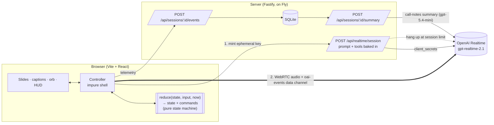
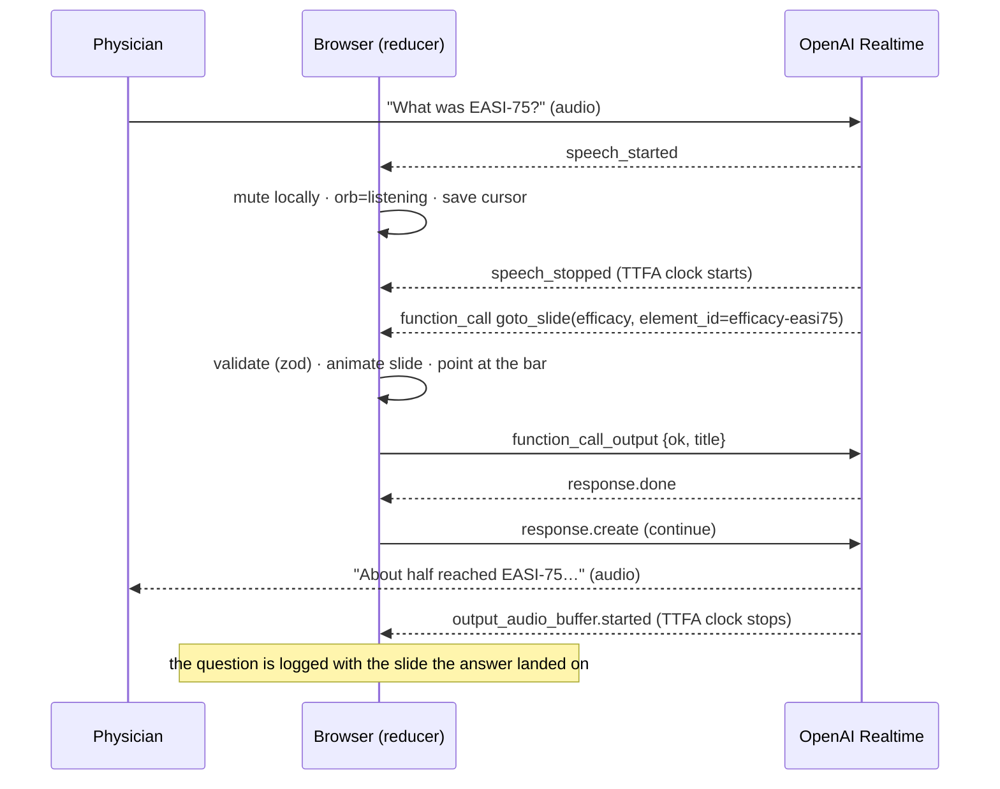
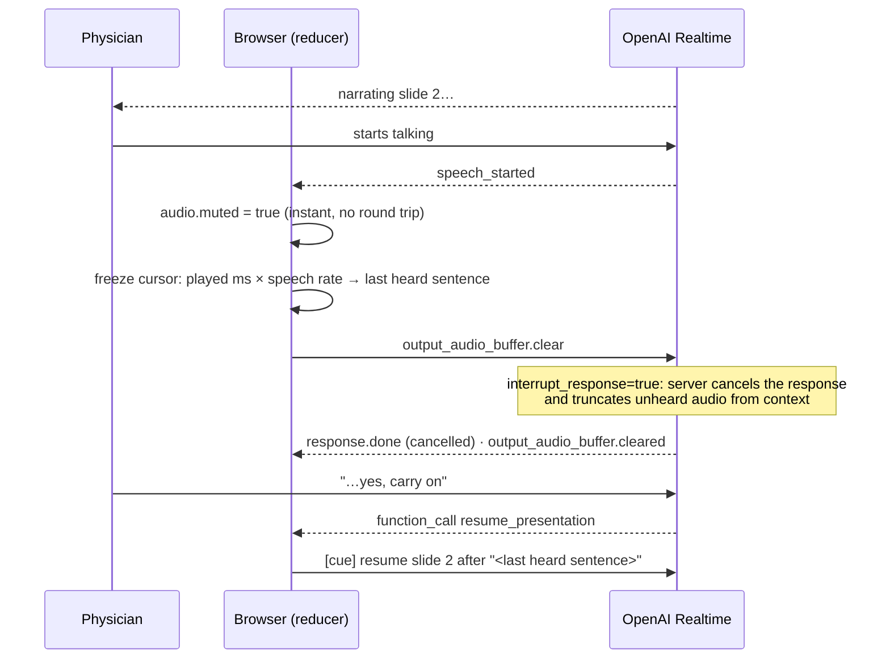

# Architecture



## Key decisions

- **The secret stays server-side.**
  - The browser never sees the API key, the system prompt, the speaker notes or the hidden `knowledge` field.
  - The server bakes them into a 60-second ephemeral key, and `GET /api/decks/:id` returns only what is on screen.
- **One pure reducer runs the whole conversation** (`web/src/agent/machine.ts`).
  - Inputs: server events, clicks and connection changes.
  - Outputs: new state plus commands (`send`, `mute`, `telemetry`, `end_call`).
  - Nothing in it touches WebRTC or the DOM, so every race is a plain unit test: barge-in during a tool call, Stop before `response.created`, navigation while a cancel is in flight, a lost `response.create` race, reconnect.
- **The app sets the pace; the model routes questions.**
  - When a slide's audio *finishes playing* (`output_audio_buffer.stopped`, not `response.done`), the client advances and sends a short `[cue] present slide X`.
  - Pacing stays deterministic and auditable, and each slide needs one fewer model round trip.
- **Data-driven deck.**
  - zod schemas in `/shared` validate decks and tool arguments, and generate the JSON Schema sent to OpenAI.
  - Layouts are derived from element types, so any deck renders without layout code.
- **One tool turn before speaking.**
  - Each tool call ends the model's turn, and the client must reply before the model can talk.
  - Answers on the current slide make no tool call; cross-slide answers make one (`goto_slide` with `element_id`).
  - Two tool calls per answer gave a 1.4 s median time-to-first-audio in a live test.

## Tools

| Tool | Purpose |
|---|---|
| `goto_slide(slide_id, reason, element_id?)` | Navigate, and optionally point, in one call |
| `highlight(element_id)` | Laser pointer on the current slide |
| `flag_for_followup(type, summary)` | Compliance log: `adverse_event`, `off_label`, `out_of_scope` |
| `resume_presentation()` | Hand control back to the script. After `goto_slide` in the same turn it continues from that slide ("next slide") |
| `end_call()` | Goodbye plays, then the call closes and the notes open |

`resume_presentation` and `end_call` go beyond the brief: the client can't reliably infer "carry on" or "let's stop" from a transcript.

## Question → slide change



## Interrupt



- `Space` and the Stop button send `response.cancel` followed by `output_audio_buffer.clear` (the order OpenAI's own SDK uses).
- **Narration cursor:**
  - Transcript text arrives *ahead* of the audio, so "what was heard" is estimated as playback time × speaking rate.
  - The rate is recalibrated on every response that plays to the end, and only sentences ending in punctuation count as heard.
  - The captions strike through the part that was cut off.

## Engineering notes

- **Cost guard:**
  - 10 sessions per IP per hour; ephemeral keys live 60 s.
  - Each session has an 8-minute budget, shown as a UI countdown. The server hangs up the call itself (`/v1/realtime/calls/{id}/hangup`), so a modified client can't run up the bill.
- **Reconnect:** 3 retries with backoff. The new session has no memory, so it is re-seeded with a recap and resumes from the narration cursor.
- **Mic denied:** the call connects receive-only; a text box drives the same session.
- **Call notes:**
  - Questions, flags, slides seen and latency medians come from the SQLite event log.
  - One text-model call selects which logged utterances were real questions and writes a 2–3 sentence summary, cached per session. If it fails, the notes still render.
- **Quality:** TypeScript strict with `noUncheckedIndexedAccess`, no `any`, and zod at every trust boundary (deck files, tool arguments, server events, telemetry).

## Layout

```
shared/   deck + tool + telemetry schemas (zod)
server/   Fastify API · prompt builder · SQLite · eval (src/eval)
web/      React UI · realtime/ (WebRTC, events) · agent/ (reducer, tools, cursor, controller)
```
